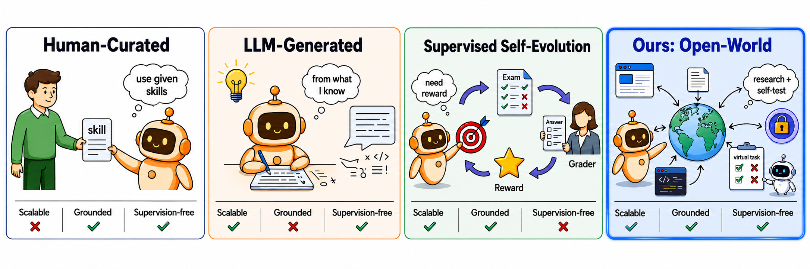
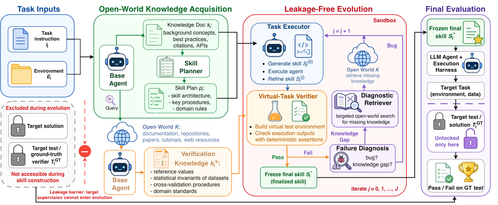
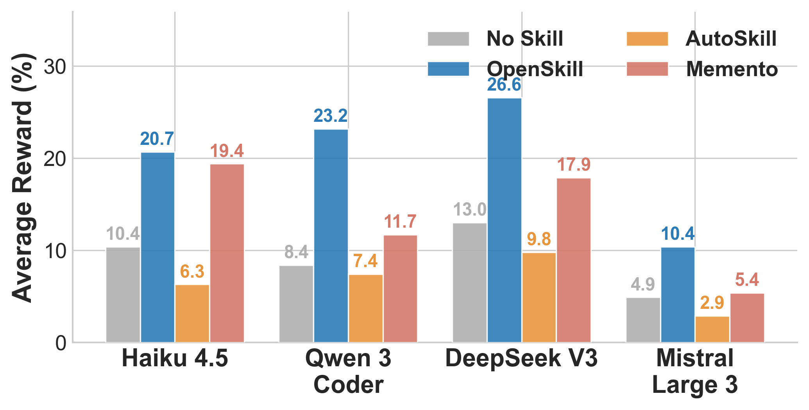
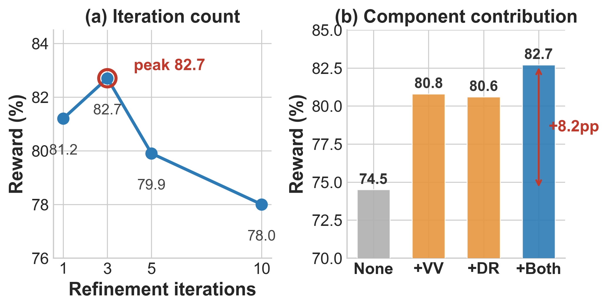
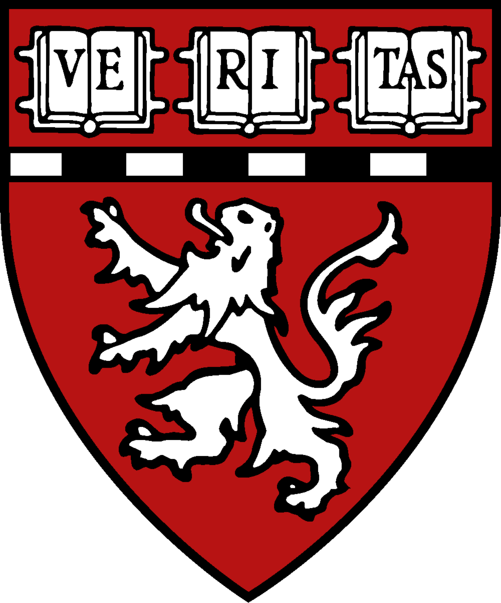

<div align="center">

# 🧭 OpenSkill

### Open-World Self-Evolution for LLM Agents

*An agent that builds both its skills and its own verification signals from scratch — using only a task prompt and open-world resources, with **no target-task supervision**.*

[](https://openlair.github.io/openskill/)
[](https://arxiv.org/abs/2606.06741)
[](https://huggingface.co/papers/2606.06741)
[](https://github.com/OpenLAIR/OpenSkill)
[](LICENSE)

</div>

---

## 📰 News

- **2026/08** 🎉 OpenSkill is accepted by **EMNLP 2026**!
- **2026/05** 🚀 Initial release of OpenSkill.

---

## Overview

Self-evolving agents need to adapt *after* deployment — but existing methods assume a usable learning loop is already there: curated skills, successful trajectories, or verifier signals. Real open-world deployments may offer **none of these**, only a task prompt.

**OpenSkill** studies *open-world self-evolution*: an agent must build **both its skills and its own verification signals from scratch**, drawing on open-world resources but **no target-task supervision**. Target-task supervision is reserved strictly for final evaluation.

<div align="center">
<table>
<tr>
<td align="center" width="33%"><b>📈 Scalable</b><br/><sub>Skills are sourced from the open world, not bounded by a human's or model's prior knowledge.</sub></td>
<td align="center" width="33%"><b>🌐 Grounded</b><br/><sub>Knowledge and verification anchors come from real docs, repositories, and the web.</sub></td>
<td align="center" width="33%"><b>🔒 Supervision-free</b><br/><sub>No gold answers, rewards, or verifier outputs during learning — a leakage barrier keeps them out.</sub></td>
</tr>
</table>
</div>

---

## The Idea — a new paradigm for self-evolving skills

Unlike human-curated, LLM-generated, or supervised self-evolution, OpenSkill acquires skills from the open world and verifies them with self-built virtual tasks — making it **simultaneously scalable, grounded, and supervision-free**. Prior paradigms each miss at least one of these properties.

<div align="center">

</div>

---

## How OpenSkill works

Given only a **task prompt**, a **base model**, **tool access**, and **open-world resources**, OpenSkill bootstraps a learning loop from scratch in three stages.

| Stage | Name | What happens |
|:-----:|:-----|:-------------|
| **01** | **Open-world knowledge acquisition** | Retrieves task-relevant knowledge and independent verification anchors from docs, repos, papers, and the web — then drafts a structured skill plan. |
| **02** | **Leakage-free skill evolution** | Drafts skills and refines them in a sandbox against self-built virtual tests grounded in the anchors, fixing bugs and knowledge gaps over up to three rounds. |
| **03** | **Zero-shot target evaluation** | Deploys the *frozen* skill to the target agent. Ground-truth tests are unlocked only here, at final evaluation — never during construction. |

<div align="center">

<br/><sub>A leakage barrier keeps target supervision out of skill construction, unlocking it only for final evaluation.</sub>
</div>

---

## 🚀 Getting Started

### Requirements

- Python **3.12+** and [`uv`](https://docs.astral.sh/uv/)
- **Docker** (each task runs in its own container)
- API keys: **Anthropic** (skill creation & evaluation), **Gemini** (deep research & search grounding), optionally **OpenAI** (Codex evaluation)

### Installation

```bash
git clone https://github.com/OpenLAIR/OpenSkill.git
cd OpenSkill
uv sync --locked          # pinned dependency tree, including the Harbor sandbox framework
cp .env.example .env      # then fill in your API keys
```

All dependency versions (including the Harbor evaluation framework and the `google-genai` SDK) are pinned in `uv.lock` to the exact versions the release was validated with.

### Repository layout

```
OpenSkill/
├── libs/
│   ├── openskill/               # the OpenSkill pipeline
│   │   ├── pipeline.py          #   Stage 1–3 orchestrator 
│   │   ├── run_pipeline.py      #   CLI: evolve skills from scratch
│   │   ├── run_eval.py          #   CLI: zero-shot evaluation of existing skills
│   │   ├── openskill_evolution.py #  in-container skill-creator agent 
│   │   ├── agent_planner.py     #   research-query synthesis        
│   │   ├── skill_planner.py     #   multi-skill plan + references   
│   │   ├── deep_research_client.py # deep-research retrieval        
│   │   └── targeted_dr.py       #   gap-vs-bug diagnosis & retrieval 
│   └── terminus_agent/          # agent runtime: skill discovery, virtual verifier,
│                                #   pytest parsing, evaluation-agent wrappers
├── .claude/skills/skill-creator/ # meta-skill injected into the creator agent
├── tasks/                       # 84 SkillsBench tasks — no skills
├── tasks-evolved/               # the same tasks + skills evolved by OpenSkill + retrieved docs
└── pyproject.toml / uv.lock / LICENSE / .env.example
```

Two copies of the benchmark ship with the repo:

- **`tasks/`** — clean task definitions (instruction, environment, hidden tests). The input for evolving skills from scratch.
- **`tasks-evolved/`** — identical tasks with the **released evolved skills** (`environment/skills/evo-*`) and the retrieved knowledge documents (`environment/doc/`) used in the paper. The input for reproducing the main results.

---

## 📊 Reproducing the main results

Evaluate the released skills with a fresh target agent (Claude Code + Opus 4.6, the paper's main setting). Ground-truth tests run only in this stage:

```bash
uv run python -m libs.openskill.run_eval \
    --tasks 3d-scan-calc \
    --tasks-dir tasks-evolved \
    --eval-agent claude-code \
    --model anthropic/claude-opus-4-6 \
    --eval-runs 5
```

- `--eval-runs 5` follows the paper protocol (n_eval = 5 independent zero-shot runs per task).
- `--eval-agent` selects the target harness: `claude-code` or `codex`.
- To sweep the whole benchmark, pass `--tasks $(ls tasks-evolved)`.
- On machines with slow disks, add `--timeout-multiplier 4` to scale the per-task Docker build and agent timeouts.

Results are appended to `results/eval_results.csv` (per-task reward and test-level accuracy).

---

## 🧬 Evolving skills from scratch

Run the full three-stage pipeline on a clean task — deep research, skill planning, verification-anchor retrieval, sandboxed evolution against the virtual verifier, then a 5-run evaluation of the newly evolved skills:

```bash
uv run python -m libs.openskill.run_pipeline \
    --tasks 3d-scan-calc \
    --eval-runs 5
```

The pipeline copies the task from `tasks/` into an isolated `workspace/`, strips any pre-existing skills or documents, and never exposes the hidden test suite to the creator or the verifier. Evolved skills land in `workspace/<task>/environment/skills/evo-*`; the full evolution trace (interventions, virtual-test results, verifier sessions) is stored under `jobs/<job-name>/`.

> [!NOTE]
> Skill evolution is stochastic. On tasks whose instructions under-specify conventions
> (units, interface variants, event definitions), a single evolution run can converge to a
> convention that differs from the hidden tests, so per-task rewards vary across runs.
> The skills in `tasks-evolved/` are the validated versions used for the paper's numbers;
> use them for exact reproduction, and expect run-to-run variance when re-evolving from scratch.

---

## Results — best automated pass rate on every setting

On **SkillsBench** (11 domains) OpenSkill beats the strongest closed-world baseline by **+8.9 / +8.8** points and lands within **1–3 points of the human upper bound** — while honoring the no-supervision constraint.

<div align="center">

| Metric | Value |
|:------|:------|
| Overall pass rate on **Opus 4.6** | **43.6%** &nbsp;(+8.9 over best baseline) |
| Overall pass rate on **GPT 5.2** | **42.1%** &nbsp;(+8.8 over best baseline) |
| GT test intents covered by self-built verifier | **88.9%** |
| Domains best / tied-best on Opus 4.6 | **8 / 11** |

</div>

**SkillsBench — overall average pass rate (%)** &nbsp;*(Human = reference upper bound, excluded from ranking)*

| Target agent | No Skill | Self-Gen | CoT | Skill-Creator | AutoSkill | Memento | **OpenSkill** | Human |
|:-------------|:--------:|:--------:|:---:|:-------------:|:---------:|:-------:|:-------------:|:-----:|
| **Opus 4.6** (Claude Code) | 25.5 | 23.9 | 23.9 | 34.7 | 24.7 | 30.1 | **43.6** | *44.5* |
| **GPT 5.2** (Codex) | 25.0 | 32.2 | 33.3 | 29.2 | 11.2 | 15.6 | **42.1** | *44.8* |

> Beyond SkillsBench, OpenSkill is also the best automated method on **SocialMaze** (82.7% / 70.7%) and **ScienceWorld** (90.0% / 85.3%) across both target agents.

---

<details>
<summary><h2>Analysis — skills transfer, the verifier aligns, every component matters &nbsp;<sub>(click to expand)</sub></h2></summary>

<br/>

<table>
<tr>
<td width="50%" valign="top">

**RQ1 — Transferability**
Skills generated by Opus 4.6 transfer **as-is** to four weaker models, improving by **+5.5 to +14.8** points over no-skill with no model-specific adaptation.

</td>
<td width="50%" valign="top">

**RQ2 — Virtual verifier quality**
Without ever seeing ground-truth tests, the verifier reaches **80.5%** recall against GT-positive outcomes, **60.7%** overall agreement, and covers **88.9%** of GT test intents.

</td>
</tr>
</table>

**RQ3 — Component contribution.** On SocialMaze, reward peaks at three refinement rounds; open-world query and the virtual verifier each improve over a parametric-only baseline and are largely complementary.

<div align="center">

&nbsp;

</div>

</details>

---

## 🗺️ Roadmap

### 🟢 Released
- [x] Project page & overview — [openlair.github.io/openskill](https://openlair.github.io/openskill/)
- [x] Paper preprint (arXiv) — [arXiv:2606.06741](https://arxiv.org/abs/2606.06741)
- [x] Core **OpenSkill** framework code (knowledge acquisition → skill evolution → evaluation)
- [x] Reproduction scripts for the SkillsBench main results
- [x] Evolved skills and retrieved knowledge documents for all 84 SkillsBench tasks (`tasks-evolved/`)

---

## Citation

```bibtex
@misc{yan2026openskillopenworldselfevolutionllm,
  title         = {OpenSkill: Open-World Self-Evolution for LLM Agents},
  author        = {Zhiling Yan and Dingjie Song and Hanrong Zhang and Wei Liang and Yuxuan Zhang and Yutong Dai and Lifang He and Philip S. Yu and Ran Xu and Xiang Li and Lichao Sun},
  year          = {2026},
  eprint        = {2606.06741},
  archivePrefix = {arXiv},
  primaryClass  = {cs.AI},
  url           = {https://arxiv.org/abs/2606.06741}
}
```

<details>
<summary><h2>Authors &amp; Affiliations &nbsp;<sub>(click to expand)</sub></h2></summary>

<br/>

Zhiling Yan<sup>1,\*</sup>, Dingjie Song<sup>1,\*</sup>, Hanrong Zhang<sup>2</sup>, Wei Liang<sup>1</sup>, Yuxuan Zhang<sup>3,4</sup>, Yutong Dai<sup>5</sup>, Lifang He<sup>1</sup>, Philip S. Yu<sup>2</sup>, Ran Xu<sup>5</sup>, Xiang Li<sup>6</sup>, Lichao Sun<sup>1,†</sup>

<sup>1</sup> Lehigh University &nbsp;·&nbsp; <sup>2</sup> University of Illinois Chicago &nbsp;·&nbsp; <sup>3</sup> University of British Columbia &nbsp;·&nbsp; <sup>4</sup> Vector Institute &nbsp;·&nbsp; <sup>5</sup> Salesforce AI Research &nbsp;·&nbsp; <sup>6</sup> Massachusetts General Hospital & Harvard Medical School

<sub>\* Equal contribution &nbsp;&nbsp; † Corresponding author</sub>

<div align="center">
<br/>
 &nbsp;&nbsp;
 &nbsp;&nbsp;
 &nbsp;&nbsp;
 &nbsp;&nbsp;
 &nbsp;&nbsp;

</div>

</details>

---

<div align="center">
<sub><b>OpenSkill</b> · Open-World Self-Evolution for LLM Agents · 2026 · <a href="https://github.com/OpenLAIR">OpenLAIR</a></sub>
</div>
